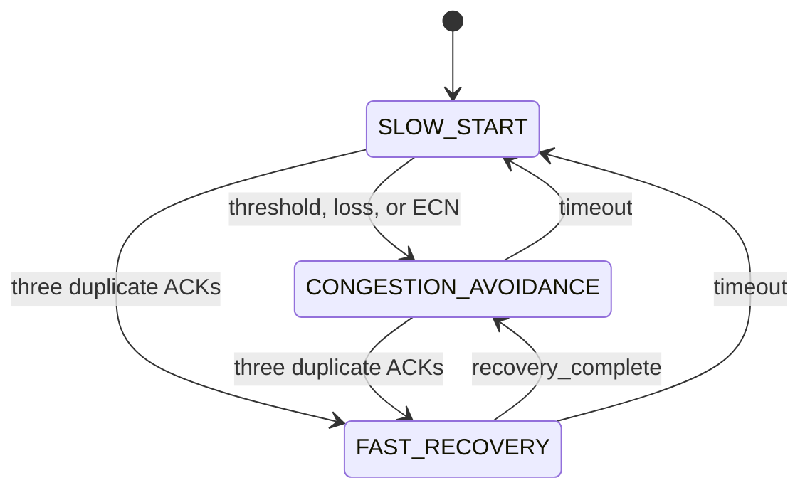

# Algorithm Design

**Track C: Congestion Control — Saint Louis University**

## Algorithm choice and units

`CongestionController` is an abstract interface with independent per-flow window
and RTT state. `step(feedback)` returns a paced rate in bytes/second:

```text
send_rate = cwnd * mss / rtt_estimate
```

`AIMDController` adds one packet after a successful round and halves its window
once if the round reports loss or ECN, with a one-packet floor. A round without
newly acknowledged bytes does not grow the window.

`RenoController` adds slow start, congestion avoidance, fast recovery, and
timeout response. Its state transitions use the concepts in
[RFC 5681](https://www.rfc-editor.org/rfc/rfc5681.html), adapted to per-RTT
feedback. This educational aggregate controller is not a complete TCP stack.

## State variables

| Variable | Meaning |
|---|---|
| `cwnd` | Window in packets; may be fractional after halving |
| `ssthresh` | Slow-start threshold in packets |
| `mss` | Payload bytes, equal to the traffic packet size |
| `srtt` | Smoothed RTT in seconds, initially unavailable |
| `rttvar` | RTT deviation in seconds, initially unavailable |
| `initial_rtt` | Positive pacing estimate before measured feedback |
| `state` | Slow start, congestion avoidance, or fast recovery |
| `transitions` | Recorded old/new state pairs |

The CLI estimates initial RTT as two propagation delays plus one packet's
service time. Sharing a controller instance between flows is rejected.

## RTT estimation

The first valid sample R sets SRTT to R and RTTVAR to R/2. Subsequent samples use:

```text
rttvar = 0.75 * rttvar + 0.25 * abs(old_srtt - R)
srtt   = 0.875 * old_srtt + 0.125 * R
rto    = max(1.0, srtt + max(0.001, 4 * rttvar))
```

RTTVAR uses the previous SRTT, following
[RFC 6298](https://www.rfc-editor.org/rfc/rfc6298.html). Fallback RTTs do not update
the estimator. The scheduler discards measurements for sequences that were
retransmitted, avoiding ambiguous sample timing.

## Reno state machine



- Slow start doubles the window per successful RTT up to the threshold.
- Congestion avoidance adds one packet per successful RTT.
- Loss or ECN without duplicate-ACK recovery halves the window once.
- Three duplicate ACKs set `ssthresh = max(2, cwnd / 2)` and enter fast recovery
  with the threshold plus duplicate-ACK inflation.
- Further duplicate ACKs inflate the recovery window. Completion deflates it to
  the threshold and returns to congestion avoidance.
- Timeout sets the threshold to at least half the prior window and restarts at
  one packet in slow start.

Duplicate ACKs can accumulate across feedback intervals. ACK progress resets
the duplicate count. Recovery ends after an ACK reaches the sender covering the
recovery boundary. Current state and recorded transitions are observable.

## Feedback interface

Every estimated RTT, the simulator passes an immutable `MappingProxyType`.

| Field | Type | Meaning |
|---|---|---|
| `rtt` | float | Mean measured RTT this round, or previous estimate |
| `rtt_sample_valid` | bool | RTT is a measurement rather than a fallback |
| `loss` | bool | At least one attempted transmission dropped this round |
| `ecn` | bool | At least one acknowledged packet was marked |
| `bytes_acked` | int | Newly acknowledged unique payload bytes |
| `packets_sent` | int | Attempts, including retries |
| `packets_dropped` | int | Random or buffer drops among attempts |
| `duplicate_acks` | int | New out-of-order reception ACK signals |
| `ack_advanced` | bool | ACK progress since previous feedback |
| `timeout` | bool | An outstanding packet reached the estimated timeout |
| `recovery_complete` | bool | ACK progress passed the recovery boundary |

The original four-field contract is retained, with optional fields making
recovery observable. Direct callers may omit optional fields; a plain RTT sample
is assumed valid unless marked otherwise. Neither controller changes feedback.

## Simulation

The event heap orders paced sends, receiver arrivals, ACK arrivals, and feedback
by simulated time; equal-time events use stable insertion order. Sends are
spaced by `mss / send_rate` and outstanding packet count is limited by the
integer window. Retries precede new payloads.

The FIFO serializes packets for `size * 8 / bandwidth` seconds. Capacity includes
the packet in service. Full buffers tail-drop; accepted packets above the ECN
fraction are marked. Forward and return propagation delay determine ACK timing.
A seeded local RNG controls initial pacing phases, random loss, and extra
forward jitter. Fixed-rate background traffic shares the link.

Per-round drop feedback and timeout identify retry sequences. Receiver gaps
generate duplicate-ACK signals. Sequence bookkeeping avoids counting payload
twice. The model uses per-packet ACKs and ideal per-round loss reporting rather
than a full TCP cumulative-ACK and retransmission timer implementation.

## Metrics and evaluation

Only feedback, time, queue depth, and controller state reach `MetricsRecorder`.
Metric calculation belongs to telemetry. Stored history is immutable and
snapshots are detached copies.

CSV/JSON throughput is bytes/second, RTT is milliseconds, and loss is percent.
Jain's index is `sum(x)^2 / (n * sum(x^2))`; empty/all-zero input returns zero by
documented convention. Scaling rates before calculation avoids overflow.

Summary throughput divides cumulative unique acknowledged bytes by each flow's
active duration. Time-series fairness uses the latest interval rates. Recording
the final partial interval keeps exported counters consistent with the summary.
RTT mean and variance summarize recorded interval samples.

Compare both algorithms with identical link settings and seeds, then exercise
loss, small buffers, staggered starts, and cross-traffic. Integration requires
five positive flow rates, fairness >= 0.9, matching parseable exports, and
execution under 30 wall-clock seconds. See [evaluation results](evaluation.md).
